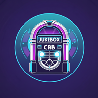
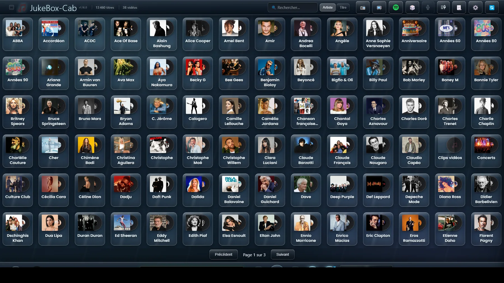
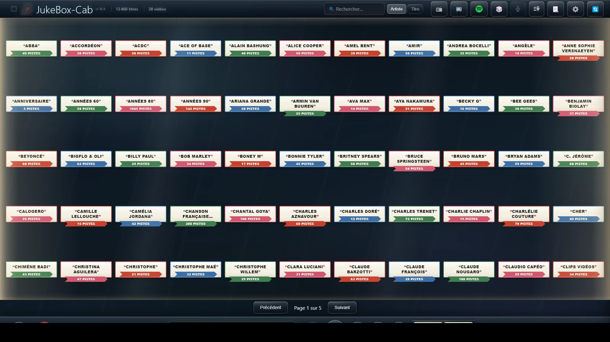
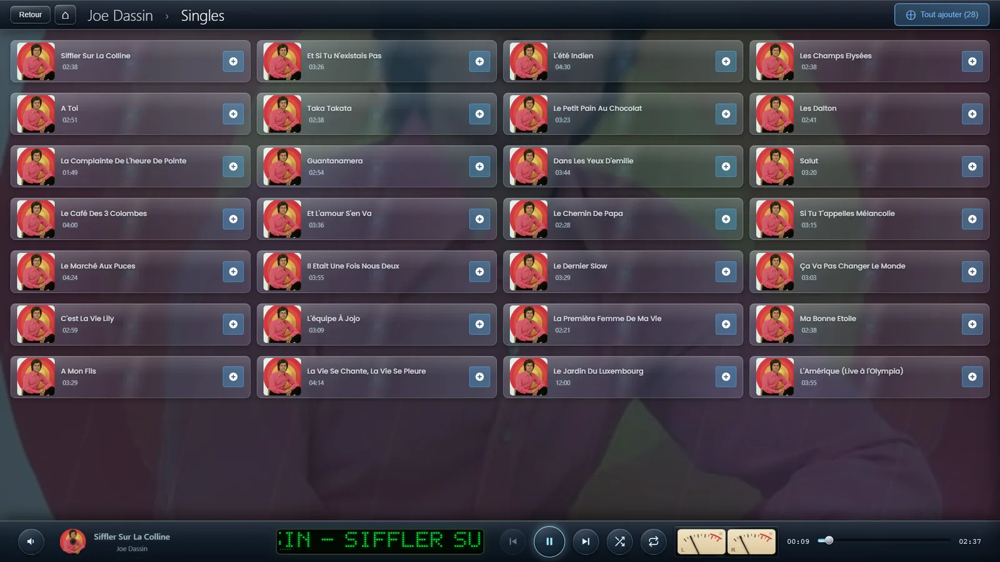
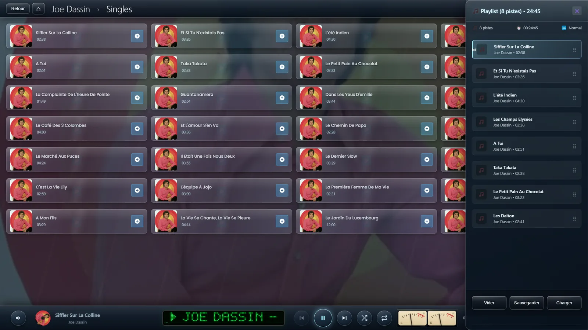
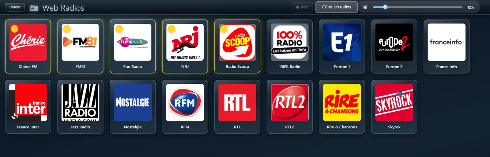

# JukeBox-Cab

**Un jukebox tactile pour bornes, bartops et kiosques.**
Musique locale, clips vidéo, web radios, YouTube et karaoké — sur un écran ou deux.

**[Télécharger](https://www.jukebox-cab.fr/#telecharger)** · **[Site](https://www.jukebox-cab.fr/)** · **[Aide](https://www.jukebox-cab.fr/aide)** · **[Read in English](README.md)**

> **Gratuit, mais pas open source.** Le code source n'est pas diffusé. Ce dépôt
> existe pour que les versions soient faciles à trouver et les bugs faciles à
> signaler. Si vous cherchiez du code à lire ou à forker, ce n'est pas ce genre de
> projet — la [licence](LICENSE) dit précisément ce qui est permis et ce qui ne
> l'est pas.

---

## Ce que c'est

Vous lui indiquez les dossiers où votre musique se trouve déjà. Il ne déplace, ne
copie et ne renomme jamais un seul fichier. Quelques minutes plus tard, votre
collection est un mur de pochettes que vous parcourez au doigt — et c'est tout le
propos : quelque chose qu'on met dans une borne, dans un bar, ou sur un écran
accroché au mur du salon, et qu'on tend à quelqu'un qui ne l'a jamais vu.

Il tourne en plein écran, barre des tâches masquée, accepte une manette ou un
panneau d'arcade aussi bien qu'un écran tactile, et peut occuper un second écran
avec les clips pendant que la bibliothèque reste utilisable sur le premier.

## Ce qu'il fait

**Votre bibliothèque telle qu'elle est.** MP3, FLAC, WAV, AAC et OGG ; MP4 et MKV
pour la vidéo. Par dossiers ou par étiquettes, pochette intégrée ou `folder.jpg`,
13 000 titres sans broncher. Scan incrémental : une relecture ne regarde que ce qui
a changé.

**Une lecture soignée.** Fondu enchaîné entre les morceaux, et uniformisation du
volume selon la norme EBU R128 — chaque titre mesuré une fois sur toute sa durée et
ramené au même niveau perçu, pour qu'une ballade ne soit pas noyée après un morceau
poussé fort.

**Deux écrans.** Les clips sur le second pendant que la bibliothèque reste
disponible sur le premier. Sur un écran unique, ils passent en plein écran avec un
bouton pour les masquer, et la barre du lecteur revient quand vous le voulez.

**Un jukebox, pas seulement un lecteur.** Mode à monnayeur avec touche de crédit
configurable, paramètres protégés par code, et retrait automatique des titres joués.
Une platine 45 tours animée entre les chansons, dessinée en direct avec la vraie
étiquette de l'album. Onze thèmes, sept habillages de grille et cinq formes de
tuiles.

**Karaoké.** Paroles synchronisées, mot à mot quand un fichier mot à mot existe,
ligne par ligne depuis un simple `.lrc` sinon. Sur le second écran si vous en avez
un, pour que la bibliothèque reste utilisable pendant que quelqu'un chante.

**Import de CD audio.** Insérez un disque, cochez les pistes : elles arrivent dans
votre bibliothèque en FLAC sans perte, avec étiquettes et pochette, identifiées par
MusicBrainz et Discogs. Les coffrets, les compilations et les disques que personne
ne connaît sont tous gérés.

**Web radios et YouTube.** Streaming ICY pour les radios, yt-dlp pour YouTube,
enregistrement de session en MP3 ou FLAC.

**Quatre langues.** Français, anglais, espagnol et italien, dans l'application
comme dans l'aide.

 

## Ce qu'il vous faut

| | |
|---|---|
| **Windows** | Windows 10 ou 11, 64 bits. Un installeur, aucune dépendance à récupérer. |
| **Raspberry Pi** | Un Pi 4 (4 Go ou plus) et une image prête à flasher. [Détails ici](https://www.jukebox-cab.fr/raspberry-pi). |
| **Écran** | À partir d'une dalle de borne en 1024×600. Le tactile est idéal, la souris et la manette fonctionnent aussi. |
| **Votre musique** | Sur un disque local, un disque externe ou un NAS. Plusieurs dossiers à la fois, sans problème. |

## Télécharger

Les versions sont publiées [ici](https://github.com/Didtho/jukebox-cab/releases) et
sur **[jukebox-cab.fr](https://www.jukebox-cab.fr/#telecharger)**, avec en plus
l'image Raspberry Pi, trop volumineuse pour être attachée à une version.

**Windows vous avertira la première fois.** L'installeur n'est pas signé — un
certificat de signature coûte plus par an que ce projet n'a jamais reçu.
L'avertissement dit « éditeur inconnu », pas « dangereux » ; [cette page explique
comment passer outre](https://www.jukebox-cab.fr/premiere-installation).

## Un point à connaître pour un usage en établissement

Dans un bar, une salle ou tout lieu ouvert au public, la diffusion de musique
enregistrée relève de la société de gestion des droits du pays (la SACEM en
France). Cela se règle entre l'établissement et elle : ce logiciel ne fournit ni ne
remplace aucune autorisation de ce genre, et rien ici ne change ce qui vous est dû
de payer.

## Obtenir de l'aide

| | |
|---|---|
| **Guides** | [jukebox-cab.fr/aide](https://www.jukebox-cab.fr/aide) — pas à pas, avec captures, en quatre langues. Les mêmes guides sont dans l'application, derrière les boutons **?**. |
| **Questions, idées, montrer votre borne** | [Le groupe Facebook](https://www.facebook.com/groups/JukeBoxCab) — c'est là que se trouve la communauté. |
| **Quelque chose ne marche pas** | [Ouvrir un signalement](https://github.com/Didtho/jukebox-cab/issues/new/choose). Renseignez la version et votre système : cela évite beaucoup d'allers-retours. |

## Licence et logiciels tiers

JukeBox-Cab est gratuit, chez vous comme dans un lieu ouvert au public, sans limite
de durée ni de nombre de postes. Vous pouvez transmettre l'installeur non modifié.
Vous ne pouvez ni le modifier, ni le décompiler, ni le vendre. Le code source n'est
pas diffusé — le texte complet, en français et en anglais, est dans
[LICENSE](LICENSE).

L'installeur embarque des logiciels écrits par d'autres, appelés comme des
utilitaires séparés et soumis chacun à **sa propre** licence, dont les sources sont
disponibles auprès de leurs auteurs : **FFmpeg** (GPL v3), **fre:ac** (GPL v2),
**yt-dlp** (Unlicense) et **Node.js** (MIT).

---

Réalisé par [Didier THOMAS](https://www.jukebox-cab.fr/) · S'il a gagné sa place
dans votre borne, [un café est toujours bienvenu](https://www.jukebox-cab.fr/soutenir)

