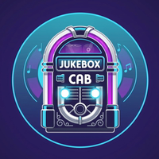
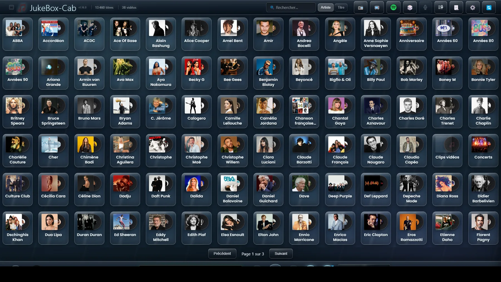
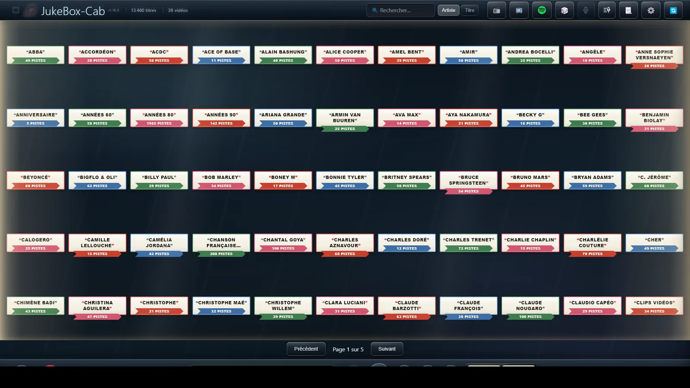
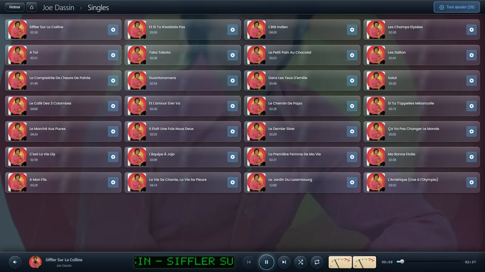
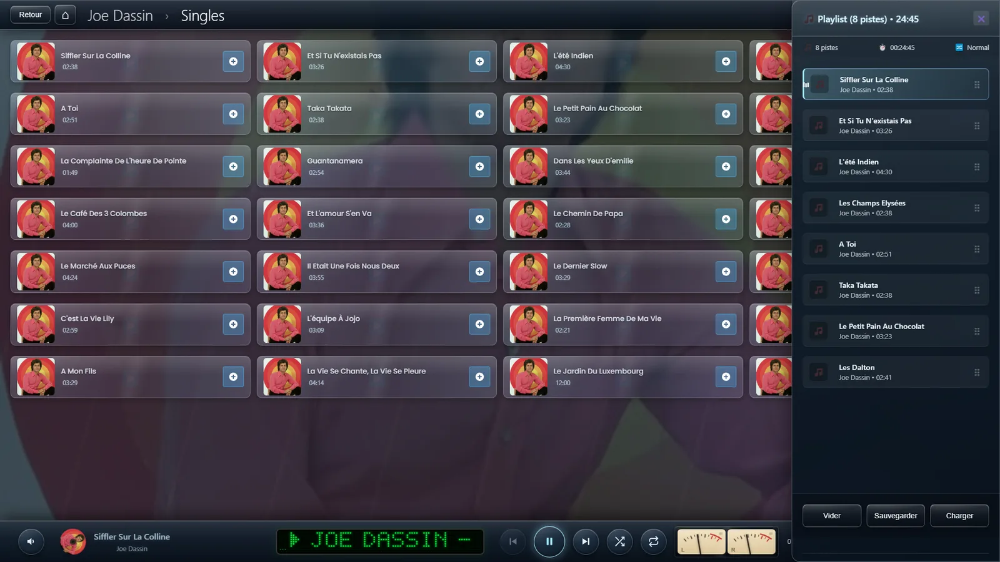
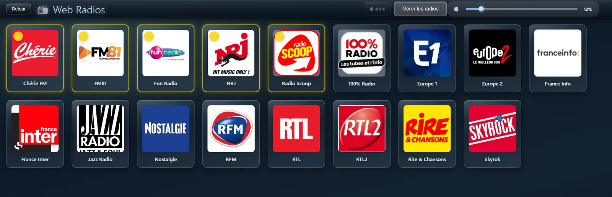

# JukeBox-Cab

**A touchscreen jukebox for cabinets, bartops and kiosks.**
Local music, video clips, web radios, YouTube and karaoke — on one screen or two.

**[Download](https://www.jukebox-cab.fr/#telecharger)** · **[Website](https://www.jukebox-cab.fr/)** · **[Help guides](https://www.jukebox-cab.fr/aide)** · **[Lire en français](README.fr.md)**

> **Free of charge, but not open source.** The source code is not published. This
> repository exists so that releases are easy to find and bugs easy to report.
> If you were looking for code to read or fork, this is not that kind of project —
> see [LICENSE](LICENSE) for exactly what is and is not allowed.

---

## What it is

You point it at the folders where your music already lives. It never moves, copies
or renames a single file. A few minutes later your collection is a wall of cover
art you browse with your finger — and that is the whole idea: something you can put
in a cabinet, in a bar, or on a wall-mounted screen in the living room, and hand to
someone who has never seen it before.

It runs full screen with the taskbar hidden, takes a gamepad or an arcade panel as
well as a touchscreen, and can run a second screen for video clips while the
library stays usable on the first.

## What it does

**Your library, as it is.** MP3, FLAC, WAV, AAC and OGG; MP4 and MKV for video.
Folder-based or tag-based, embedded artwork or `folder.jpg`, 13 000 tracks without
complaint. Incremental scanning, so a rescan only looks at what changed.

**Playback worth hearing.** Crossfade between tracks, and loudness levelling to
EBU R128 — every track measured once over its whole length and brought to the same
perceived volume, so a quiet ballad does not get buried after a loud one.

**Two screens.** Video clips on the second display while the library stays
available on the first. On a single screen they play full screen with a hide
button, and the player bar comes back when you want it.

**A jukebox, not just a player.** A coin-operated mode with a configurable credit
key, PIN-protected settings and auto-removal of played tracks. An animated 45 rpm
turntable between songs, drawn live with the actual album label. Eleven themes,
seven grid skins and five tile shapes.

**Karaoke.** Synchronised lyrics, word by word when a word-level file is
available, line by line from an ordinary `.lrc` otherwise. On the second screen if
you have one, so the library stays usable while someone sings.

**Audio CD import.** Insert a disc, tick the tracks, and they land in your library
as lossless FLAC with tags and cover art, identified through MusicBrainz and
Discogs. Box sets, compilations and discs nothing knows about are all handled.

**Web radios and YouTube.** ICY streaming for radios, yt-dlp for YouTube, session
recording to MP3 or FLAC.

**Four languages.** French, English, Spanish and Italian, in the application and
in the help guides.

| | |
|:---:|:---:|
|  |  |
| *Tracks as 45 rpm labels, behind lit glass* | *The player bar: dot-matrix display and VU meter* |
|  |  |
| *The playlist, sliding over the library* | *Web radios* |

## What you need

| | |
|---|---|
| **Windows** | Windows 10 or 11, 64-bit. An installer; no dependencies to fetch. |
| **Raspberry Pi** | Pi 4 (4 GB or more) with a ready-to-flash image. [Details here](https://www.jukebox-cab.fr/raspberry-pi). |
| **Screen** | Anything from a 1024×600 cabinet panel upwards. Touch is ideal, mouse and gamepad both work. |
| **Your music** | On a local disk, an external drive or a NAS. Several folders at once is fine. |

## Download

Releases are published [here](https://github.com/Didtho/jukebox-cab/releases), and
also on **[jukebox-cab.fr](https://www.jukebox-cab.fr/#telecharger)** along with the
Raspberry Pi image, which is too large to attach to a release.

**Windows will warn you the first time.** The installer is not code-signed —
signing certificates cost more per year than this project has ever received. The
warning says "unknown publisher", not "dangerous"; [this page explains how to get
past it](https://www.jukebox-cab.fr/premiere-installation).

## One thing to know if you run it in a venue

In a bar, a club or anywhere open to the public, playing recorded music is subject
to the collecting society for your country (SACEM in France, PRS/PPL in the UK, and
so on). That is between the venue and them — this software neither provides nor
replaces any such licence, and nothing here changes what you owe.

## Getting help

| | |
|---|---|
| **Guides** | [jukebox-cab.fr/aide](https://www.jukebox-cab.fr/aide) — step by step, with screenshots, in four languages. The same guides are built into the application behind the **?** buttons. |
| **Questions, ideas, showing off your cabinet** | [The Facebook group](https://www.facebook.com/groups/JukeBoxCab) — that is where the community is. |
| **Something is broken** | [Open an issue](https://github.com/Didtho/jukebox-cab/issues/new/choose). Please fill in the version and your system; it saves a lot of back and forth. |

## Licence and third-party software

JukeBox-Cab is free to use, at home and in public venues, with no time limit and on
any number of machines. You may pass the installer on unmodified. You may not
modify it, decompile it, or sell it. The source code is not published — see
[LICENSE](LICENSE) for the full text in French and English.

The installer carries software written by other people, invoked as separate
utilities and each under **its own** licence, with sources available from their
authors: **FFmpeg** (GPL v3), **fre:ac** (GPL v2), **yt-dlp** (Unlicense) and
**Node.js** (MIT).

---

Built by [Didier THOMAS](https://www.jukebox-cab.fr/) · If it earns a place in your
cabinet, [a coffee is always welcome](https://www.jukebox-cab.fr/soutenir)

